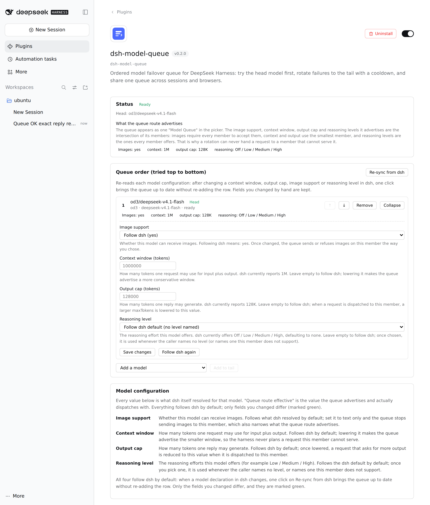
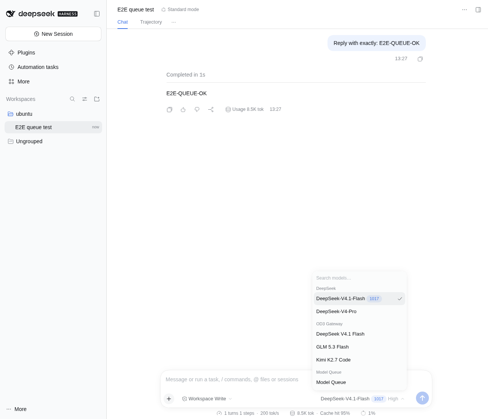
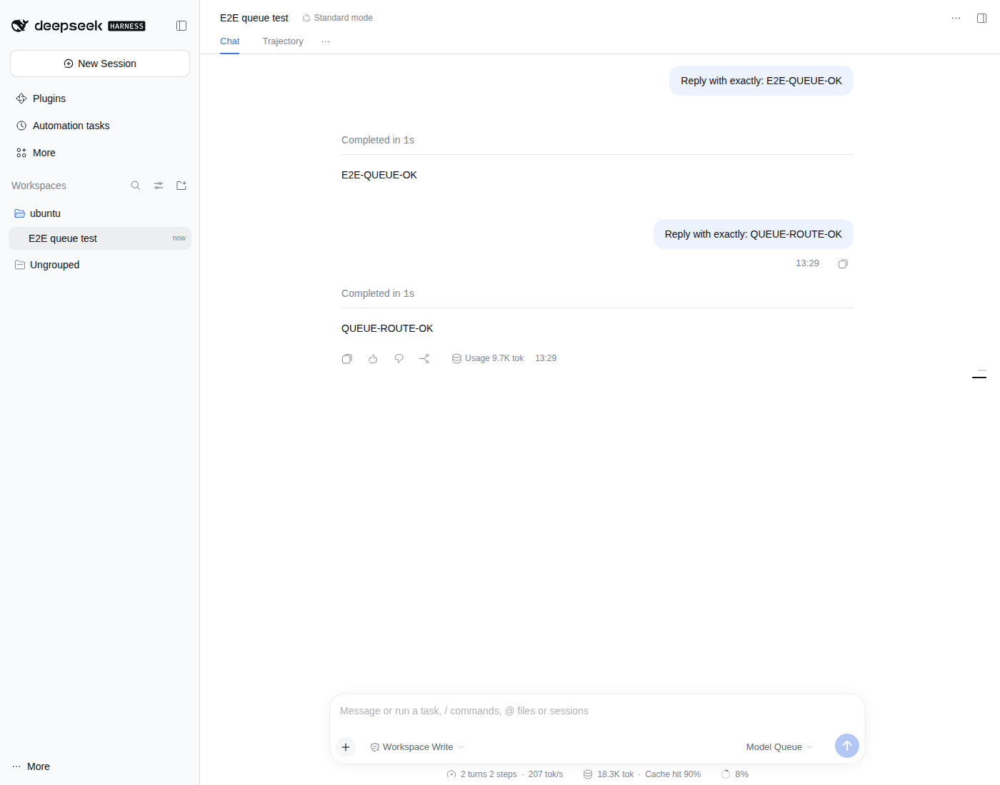

# dsh-model-queue

**给 DeepSeek Harness 的模型排队与自动轮换。** 你排好一串模型，会话只选一个「Model Queue」；队首优先，失败了就换下一个、把它挪到队尾冷却一小时。某个 provider 额度用尽时，你不用再手动切换。

队列里的每个成员都带着 dsh 自己解析出的**完整模型配置**——读图能力、上下文窗口、单次输出上限、推理等级。它不是「只填了个模型名」的槽位：选中后实际派发用的就是这套配置，和直接把该模型配进 dsh 完全一致。

## 装

```sh
dsh plugin --profile web add https://github.com/mzbot-creator/dsh-model-queue/releases/latest/download/dsh-model-queue-0.2.0.tgz
```

装的是某个具体版本的打包产物，所以拿到的东西永远可复现。把 URL 里的版本号换成想要的
版本即可；装最新版也可以走 `github:mzbot-creator/dsh-model-queue`（跟 `main` 头走）。

`lib/` 是随仓库提交的构建产物，所以装完就能直接用，不需要在安装时编译（pnpm 会拦截
git 依赖的 prepare 脚本）。

- 卸载：`dsh plugin --profile web remove dsh-model-queue`
- 从本地 checkout 装（开发用）：`dsh plugin --profile web add /path/to/dsh-model-queue`

装好之后：**Plugins → Model Queue** 里能开关、能配队列；新会话的模型选择器里多一个 **Model Queue** 分组。

## 它解决什么

你有多个 provider，额度会各自用尽。原来的做法是会话里手动换模型——你得先发现它失败了，再想起还有哪个能用。

这个插件把「换模型」变成一条流水线：

| 你的需求 | 插件里的行为 |
|---|---|
| 依次选择多个模型 | 队列是有序列表，想加几个加几个 |
| 优先使用第一个 | 每个请求都从队首取；列表里排第一的就是第一个被尝试的 |
| 失败就换下一个，并把它移到队尾、冷却 1 小时 | 同一个请求内继续试下一个；失败的进冷却，UI 上直接显示它排在队尾、还剩多少时间 |
| 队列信息存在服务端，跨浏览器、跨 session 共享 | 一份 JSON 文档存在 `$DSH_HOME/model-queue/queue.json`，所有浏览器和会话读同一份 |
| 全部冷却则任务失败，失败原因是最后一次请求的原因 | 报告最后一次尝试的原样错误码与消息 |

## 用起来是什么样



装好后新会话的模型选择器里多一个 **Model Queue** 分组：



选中它发消息，答案由队首模型给出：



**Plugins → Model Queue** 页面的细节：

- **Status**：现在能不能请求（Ready / All cooling down / Queue is empty）；全部冷却时显示最后一次失败的原因。
- **Queue order**：成员列表。队首标 `Head`；冷却中的成员显示 `Cooldown left 52min`、失败次数和上次失败原因。`↑` `↓` 调顺序，`Remove` 移除。
- **Add a model**：下拉里是宿主机当前能路由到的所有模型（插件自己的队列路由已排除），`Add to tail` 加到队尾。
- **Cooldown**：冷却时长，默认 60 分钟；`Clear every cooldown` 只清冷却、不改顺序。
- **Model configuration**：每个成员都显示 dsh 为它解析出的四项配置——读图、上下文、输出上限、推理等级；`Edit configuration` 可以逐项改（绿色标记表示已偏离 dsh），`Follow dsh again` 一键恢复。
- **Re-sync from dsh**：dsh 那边改了配置（换上下文窗口、开读图、加推理档）之后，点一次就能让队列跟上，不用删掉重加；手动改过的项不会被覆盖。
- **启用开关**：关闭后「Model Queue」从模型选择器消失，已排队的模型保持不变。

会话里：模型选择器选中 **Model Queue** 即可。之后每次请求由队列决定谁真的回答。

## 模型配置跟着 dsh 走

模型选择器里只显示名字是不够的：一个模型能不能读图、上下文多长、单次能输出多少、有哪些推理档，决定了它接不接得住这次请求。所以队列的每个成员都保存**两份配置**——dsh 解析出的原始值（`snapshot`/`resolved`），以及你手动改动的差异（`overrides`）。实际生效的是两者叠加，默认差异为空，也就是完全沿用 dsh。

加模型时立刻从 dsh 解析一次完整配置，下拉里就已经标出这四项，加进队列后不用再对一遍。

**队列路由对外公布什么。** 选择器里「Model Queue」只是一个选项，但它必须公布一套能力，宿主要据此编排请求。这套能力是所有成员的**共同可用范围**：

| 能力 | 队列路由的取值 | 为什么 |
|---|---|---|
| 读图 | 全员支持才算支持 | 否则轮换到纯文本成员时，图片会被拒或静默丢失 |
| 上下文窗口 | 取最小的成员 | 乐观值会让宿主拼出一个某成员接不住的请求，轮换后报用户无法处理的错 |
| 单次输出上限 | 取最小的成员 | 同上；超出的 `maxTokens` 会在派发时下调到该成员的上限 |
| 推理等级 | 所有成员都提供的交集 | 公布一个只有部分成员支持的档位，等于把选择权变成随机失败 |

页面上「Queue route effective」这一行就是这套聚合值，和模型卡片里看到的一致。

**逐项覆盖。** 每项都可以只改这一个成员，不影响别人：

- **读图**：强制支持或强制纯文本。想让某个成员永远不接图片，就关掉它。
- **上下文窗口 / 输出上限**：改成更保守的值。队列对外公布的总值会随之收紧。
- **推理等级**：指定这个成员在调用方没指定档位（或指定的档位它不支持）时用哪一档。这是「每个成员用自己的默认档」之外唯一的调节手段。

改过的项会一直保留，重新同步也不会被覆盖；`Follow dsh again` 清空该成员的全部覆盖。

## 失败怎么算

不是所有失败都该换模型。插件按「这是模型路由的问题，还是这次请求的问题」分类：

**换下一个（并让这个模型冷却）**——额度用尽（`QUOTA` / `ACCOUNT_QUOTA`）、限流（`RATE_LIMIT`）、上游 5xx（`SERVER`）、超时（`TIMEOUT`）、网络错误（`TRANSPORT`）、空回复（`EMPTY_RESPONSE`）、凭据缺失或失效（`MISSING_CREDENTIAL` / `INVALID_CREDENTIAL`）、路由已注销（`NO_ADAPTER`），以及**任何未识别的新错误码**。

**不换，直接失败**——上下文超长（`CONTEXT_WINDOW_EXCEEDED`）、不支持的内容/选项/推理档位、`UNKNOWN_MODEL`、取消（`ABORTED`）。这些错误在哪个模型上都会同样发生，换模型只会把整条队列白白冷却一小时，还会把「你的请求有问题」误报成「模型有问题」。

> 默认倾向「换」是刻意的：未识别的错误码更可能是 provider 新出的故障，而不是新的请求形状错误；而错误轮换的代价是自愈的——冷却结束后它自己就回来了。

## 它怎么做到的

Harness 是「一个会话选一个模型」。插件注册**一条自己的 provider 路由**（`dsh-model-queue`，只公布一个模型 `queue`），然后在每次分发时：

1. 问队列现在该用谁（队首且不在冷却中的那个）；
2. 用 `ctx.llm.stream()` 把**同一个请求**重新分发给那条真实的 provider/model；
3. 看结果——成功就交出去；失败就按上面的分类决定轮换还是失败。

所以「一条路由、一堆真实模型」这件事对会话是透明的，同一个请求内就能连续换人。

几个刻意的取舍：

- **队列路由公布的能力取成员交集**，图片能力取「所有成员都支持」才算数；而每个成员自己的配置来自 dsh 的解析结果，不是手填的字符串——这是「选了名字但行为不一致」的根因。
- **失败尝试的残缺输出不会交给会话**。否则它会被存成 assistant 消息，然后在一段半截内容上继续重试。
- **冷却时长是插件配置（`cooldownMs`），不是队列文档的一部分**，改设置不需要重写你排好的队列；`0` 仍然会轮换到队尾，只是不等待。
- **空队列默认不公布路由**。一个选得到、但必然失败的模型选项比没有更糟。想要的话可以在页面里打开 `Offer the route even when empty`。
- **每次修改都串行化并落盘后才回包**，所以两个会话同时失败不会丢掉其中一次轮换。

## 配置

`cordis.patch.yml` 里的行，也可以在 **Plugins → Model Queue** 页面改（写回 profile 的 patch 层）：

| 字段 | 默认 | 含义 |
|---|---|---|
| `enabled` | `true` | 是否公布队列路由 |
| `cooldownMs` | `3600000` | 失败后的冷却时长（毫秒），上限一年 |
| `offerWhenEmpty` | `false` | 队列为空时是否也公布路由 |

队列文档（`$DSH_HOME/model-queue/queue.json`，权限 600）故意不含 `cooldownMs`：顺序和冷却状态归文档，策略归配置。

文档损坏时会被改名隔离（`queue.json.corrupt-<时间戳>`）并从空队列开始，而不是覆盖掉唯一一份顺序记录。

## HTTP 接口

页面用这六个同源、经宿主认证的接口（前缀 `/api/dsh-model-queue`）：

| 方法 | 路径 | 作用 |
|---|---|---|
| GET | `/state` | 读整个队列视图（含剩余冷却、队首、是否全部冷却、最后失败原因） |
| GET | `/catalog` | 列出宿主上可路由的模型 |
| POST | `/entries` | 整体替换队列顺序、成员与每行的配置覆盖 |
| POST | `/sync` | 重新从 dsh 解析每个成员的完整配置（保留手动覆盖） |
| POST | `/cooldown` | 改冷却时长 |
| POST | `/reset` | 清除全部冷却 |

## 开发

```sh
npm ci
npm run typecheck   # host + client
npm run compile     # 写 lib/（产物入库）
npm run check:dist  # 校验 lib/ 与源码一致
npm test            # 61 个单测
npm run verify:load # 装进临时 profile、真的启动一次、查 API
```

`npm run verify:load` 需要 PATH 上有 `dsh` 和 `pnpm`（或用 `DSH_BIN` 指定），它不会碰你自己的 harness home。

### 发布

打一个与 `package.json` 版本一致的 tag 并推送：

```sh
git tag -a v0.2.0 -m "0.2.0" && git push origin v0.2.0
```

Release 工作流会校验 tag 与版本号一致、跑全部检查（含真的启动一次 harness）、
`npm pack`，然后把 `.tgz` 挂到 GitHub Release 上。装最新版仍然是一条命令：

```sh
dsh plugin --profile web add https://github.com/mzbot-creator/dsh-model-queue/releases/latest/download/dsh-model-queue-0.2.0.tgz
```

`npm publish` 是可选渠道：它需要仓库里配 `NPM_TOKEN`。本仓库没有配，所以工作流会
打一条 notice 跳过 npm，只发 GitHub Release —— 缺 secret 不应该让整个 release 失败。

也可以手动触发（`workflow_dispatch`），传入已有 tag 重发一次。

## 已验证与未验证

**已实测**（本机真实 dsh `0.2.1-rc.3` + 真实 provider，自建 home，无头浏览器驱动）：

- `dsh plugin --profile <p> add <release tarball URL>` 装得上（`0.2.0` 的 release 产物），插件出现在 Plugins → Installed，开关可切换
- 打 tag 推上去后 Release 工作流跑绿，`dsh-model-queue-0.2.0.tgz` 挂在 GitHub Release 上
- 页面完整渲染四项能力与每项的说明文字，无控制台错误
- 会话选中 Model Queue 并真实发消息，回复经队列路由由队首成员给出（下图即本次实测）
- 逐项改配置后即时生效：把上下文改成 200000，队列路由公布值随之收紧到 200000
- `Re-sync from dsh` 之后手动覆盖仍在；`Follow dsh again` 清空覆盖，公布值回到成员真实值
- 队首指向坏路由时，**同一个请求内**轮换到下一个成员并成功回答；坏成员移到队尾、`remainingMs ≈ 3600000`、记录了 `NO_ADAPTER`
- 两个独立浏览器上下文读到同一份队列（head 一致）
- 全部成员冷却时，错误码与消息是**最后一次失败的原样内容**

**未验证**：

- 只有 `0.2.1-rc.3` 一个宿主版本上跑过；更早的 `0.2.0-rc.x` 只做了类型层面的兼容（`engines.dsh` 写的是 `>=0.2.0-rc.1 <0.3.0`）
- 插件市场索引（`dist/plugin-index.json`）会生成本仓库的描述，但尚未发布到任何公开索引源
- 真实 provider 的**额度耗尽**没有真的打到过；轮换路径是用「不存在的路由」和「缺凭据的路由」触发的，它们与 `QUOTA` 走同一条分类分支

## 许可

MIT
